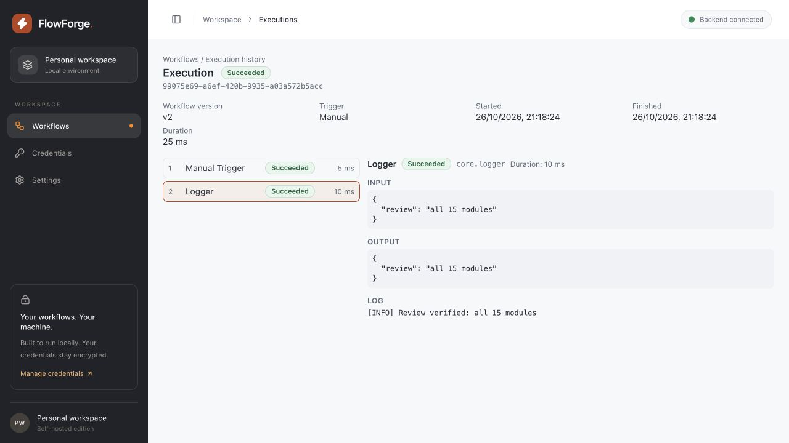

# Post-completion review — 2026-10-26

Reviewed the completed 15-module application, reproduced defects, added regression coverage, and verified the fixes against the full frontend/backend suites and an isolated Docker stack. This is a focused follow-up review, not a claim that every possible defect has been eliminated.

## Fixes

| Area | Defect and resulting behavior | Verification |
|---|---|---|
| Credential redaction | Logger nodes could write a registered credential value to the server's application log even though stored execution logs masked it. Both destinations now mask registered values before generic sanitization. Workflow data is unchanged. | Captured Logback events and stored log regression; failed before the fix. |
| Execution admission | Concurrent requests could all pass the capacity check before any queued execution was inserted. A per-workflow PostgreSQL transaction advisory lock now serializes the final count and insertion. The scheduler rolls back a capacity-rejected occurrence and continues processing other schedules. | With nine active runs and a limit of ten, eight simultaneous admissions previously all succeeded; now exactly one succeeds. Testcontainers regression and scheduler suites pass. |
| AI cancellation | Cancellation before the first request or between structured-output repair attempts could still send a provider request. Each attempt now checks cancellation and thread interruption. | Two provider-call-count regressions; both failed before the fix. |
| Dashboard navigation | A slow Run or sample-creation response could redirect the user after they had left the dashboard. Navigation and dialog callbacks now belong to the mounted mutation observer; cache invalidation remains global. | Delayed-response tests for both actions; failed before the fix. |
| Cancellation feedback | A failed cancellation was silent. Execution details now show an actionable error and allow retry; acknowledgements preserve a terminal status and invalidate the relevant caches. | Failure/retry regression failed before the fix; additional coverage confirms route isolation and terminal-state preservation. |
| Execution history | A shrinking result set could leave the user on an empty out-of-range page; switching workflows retained the previous filter and page. Pagination now recovers, workflow navigation resets local state, filters wrap, and the results table scrolls horizontally on narrow screens. | Two state regressions failed before the fix; browser check at 375 px confirms wrapped filters and a contained 640 px table. |
| AI response schemas | Negative or fractional length/item-count constraints were accepted. Frontend and backend now consistently require nonnegative integers for `minLength`, `maxLength`, `minItems`, and `maxItems`; ordinary numeric bounds remain unrestricted. | Shared fixtures cover all four keywords, negative/fractional values, and valid integral decimal values. |
| E2E environment safety | Rerunning a kept test stack could overwrite the database password and encryption key. Existing environments now block replacement and print explicit teardown instructions. A failed teardown preserves the environment file and returns an error. | Byte-for-byte preservation check on the kept environment, simulated Docker failure/rerun in a temporary directory, and Bash syntax validation. |

No database migration, API schema change, or runtime dependency was required.

## Verification results

| Check | Result |
|---|---|
| Backend `./mvnw verify` | 387 unit tests and 132 integration tests passed; one live-provider test (`AiLiveIT`) skipped. |
| Frontend `npm test` | 568 tests passed in 45 files. |
| Frontend typecheck, lint, production build | Passed; no lint warnings. The final pagination adjustment was followed by all 13 execution-page tests and a fresh build. |
| Docker API end-to-end scenarios | 11 passed: AI mock responses/retries, HTTP success/failure/outbound restrictions, condition branches, signed webhooks/replay rejection, schedules, execution recovery, backend restart, and SSE. |
| Browser workflow smoke test | Created a Manual Trigger → Logger workflow, configured input and message, connected nodes, saved, reloaded, ran successfully, and inspected outputs/logs/history through the Docker frontend. |
| Responsive history | Verified filter wrapping and horizontal table containment at 375 × 812; restored the normal viewport afterward. |
| Docker deployment | Rebuilt production backend/frontend images and verified healthy startup; final frontend rebuilt after the pagination adjustment. |

The Docker run used `scripts/e2e.sh --grep-invert 'create → save → reload → execute|a stored credential authenticates'` with `E2E_KEEP=1` for manual browser checks. The two browser-containing automated scenarios were excluded from this rerun. The editor scenario was exercised manually as described above; the credential-page browser scenario was not rerun. Historical Module 15 results remain in `TEST_REPORT.md`.

AI end-to-end verification used a mock provider; no real provider key was supplied. This follow-up did not repeat load/soak tests, accessibility audits, backup/restore, or reproducibility comparisons. Existing deployment limitations in `PRODUCTION_READINESS.md` still apply.

The isolated `flowforge-e2e` stack and its temporary data were removed after verification. The user's existing development preview was left running.

